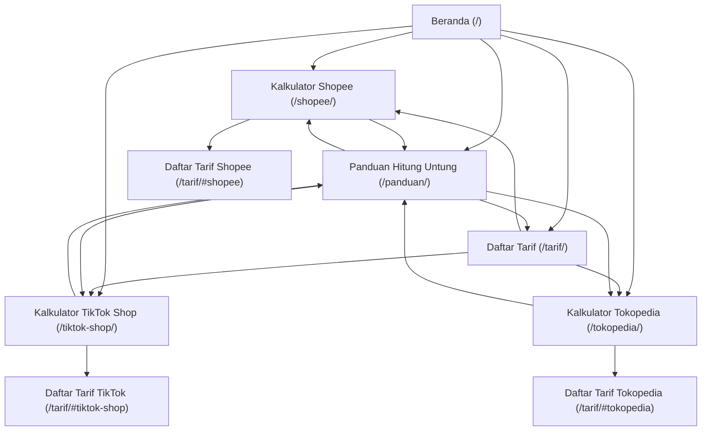

# SEO KEYWORD MAPPING: KalkulatorSeller

Dokumen pemetaan kata kunci, intensi pencarian (*search intent*), mitigasi kanibalisasi, dan arsitektur tautan internal untuk situs **KalkulatorSeller**.

> [!NOTE]
> Seluruh kata kunci di bawah ini merupakan hipotesis awal berbasis analisis search intent seller Indonesia dan taksonomi e-commerce. Validasi final akan dilakukan menggunakan data Google Search Console setelah website dipublikasikan dan mulai memperoleh impresi.

---

## 1. Matriks Pemetaan Kata Kunci per Halaman

| URL Rute | Primary Keyword | Secondary Keyword | Search Intent | Target Pengguna |
|---|---|---|:---:|---|
| `/` | **kalkulator keuntungan jualan online** | kalkulator profit marketplace, cara hitung untung jualan, kalkulator harga jual | **Tool / Commercial Investigation** | Seluruh seller pemula, UMKM, dropshipper yang ingin menghitung profit sebelum menjual |
| `/shopee/` | **kalkulator shopee** | kalkulator biaya admin shopee, hitung keuntungan shopee, potongan shopee star seller, biaya gratis ongkir xtra | **Tool / Transactional** | Penjual Shopee (Non-Star, Star, Star+, Mall) |
| `/tiktok-shop/` | **kalkulator tiktok shop** | komisi tiktok shop, hitung keuntungan tiktok shop, potongan live tiktok, komisi affiliate tiktok | **Tool / Transactional** | Penjual TikTok Shop, kreator affiliate, seller yang aktif live streaming |
| `/tokopedia/` | **kalkulator tokopedia** | biaya layanan tokopedia, kalkulator untung tokopedia, potongan power merchant tokopedia, biaya bebas ongkir | **Tool / Transactional** | Penjual Tokopedia (Power Merchant, Regular, Official Store) |
| `/tarif/` | **biaya admin marketplace** | potongan marketplace 2026, tarif admin shopee tiktok tokopedia, perbandingan biaya marketplace | **Informational / Reference** | Seller yang ingin membandingkan potongan resmi antar marketplace |
| `/panduan/` | **cara menghitung keuntungan jualan online** | cara menentukan harga jual produk, cara hitung hpp jualan online, rumus untung bersih seller | **Informational / Educational** | Penjual pemula yang bingung menentukan harga awal dan menghitung modal HPP |
| `/privacy-policy/`| **kebijakan privasi kalkulatorseller** | keamanan data kalkulator seller, kalkulator tanpa server | **Informational / Trust** | Pengguna yang mengutamakan keamanan rahasia modal dan margin bisnis |
| `/terms/` | **syarat ketentuan kalkulatorseller** | disclaimer perhitungan marketplace, simulasi estimasi keuntungan | **Informational / Trust** | Pengguna yang ingin memahami batasan estimasi perhitungan |

---

## 2. Strategi Search Intent & Nilai Tambah Konten

### A. Tool / Transactional Intent (`/shopee/`, `/tiktok-shop/`, `/tokopedia/`)
- **Karakteristik Pengguna**: Menginginkan hasil cepat. Pengguna biasanya sedang membuka Seller Center atau sedang menyusun etalase produk baru dan butuh angka pasti berapa modal dan harga jual yang tepat.
- **Nilai Tambah yang Disediakan**:
  - Interactive live calculator tanpa reload halaman.
  - Pilihan mode: **Hitung Keuntungan (Forward)** atau **Cari Harga Jual Ideal (Reverse)**.
  - Rincian 4 tahap keuntungan (Untung Kotor &rarr; Setelah Potongan &rarr; Setelah Packing &rarr; Bersih).
  - Edukasi biaya khusus platform di bagian bawah kalkulator.

### B. Informational Intent (`/panduan/`, `/tarif/`)
- **Karakteristik Pengguna**: Masih dalam tahap belajar atau evaluasi. Sering mencari tahu mengapa toko ramai tapi saldo pencairan selalu defisit, atau ingin membandingkan platform mana yang potongannya paling rendah.
- **Nilai Tambah yang Disediakan**:
  - Contoh kasus riil (misal menjual kemeja Rp100.000 dengan modal Rp50.000).
  - Tabel transparansi tarif resmi lengkap dengan batas maksimal pemotongan (cap) dan tanggal verifikasi.
  - Tautan kontekstual langsung (*direct tool links*) menuju kalkulator platform terkait.

---

## 3. Pencegahan Risiko Kanibalisasi Kata Kunci (*Keyword Cannibalization*)

Kanibalisasi terjadi bila dua atau lebih halaman bersaing menargetkan kata kunci yang sama tanpa batasan intensi yang tegas.

| Pasangan Halaman yang Berpotensi Bentrok | Potensi Risiko | Strategi Pemisahan & Mitigasi |
|---|---|---|
| **Homepage (`/`) vs `/shopee/`** | Keduanya bisa memicu pencarian "kalkulator shopee" | Homepage fokus pada **terminologi umum multi-platform** ("kalkulator keuntungan jualan online", "perbandingan biaya marketplace"). Halaman `/shopee/` fokus mendalam pada entitas spesifik Shopee ("kalkulator shopee", "biaya admin star seller"). |
| **`/panduan/` vs Halaman Marketplace** | Panduan menargetkan cara hitung untung yang mirip dengan intro tools | `/panduan/` fokus pada **rumus fundamental HPP, pembagian 4 tahap laba, dan edukasi akuntansi dasar seller**. Halaman kalkulator fokus pada simulasi numerik interaktif. |
| **`/tarif/` vs Halaman Marketplace** | Keduanya memuat angka persentase biaya | `/tarif/` berfungsi sebagai **tabel referensi katalog regulasi dan tautan provenance resmi**. Halaman kalkulator mengintegrasikan aturan tersebut ke dalam kalkulasi dinamis. |

---

## 4. Arsitektur Tautan Internal (*Internal Linking Map*)

### Aturan Anchor Text Internal:
1. Hindari anchor text generik seperti "klik di sini" atau "link".
2. Gunakan anchor deskriptif:
   - Menuju Shopee: *"Kalkulator Shopee"*, *"Hitung keuntungan Shopee"*
   - Menuju TikTok Shop: *"Kalkulator TikTok Shop"*, *"Rincian komisi TikTok Shop"*
   - Menuju Tokopedia: *"Kalkulator Tokopedia"*, *"Tabel grup tarif Tokopedia"*
   - Menuju Tarif: *"Daftar Tarif & Potongan Marketplace"*, *"Lihat aturan resmi"*
   - Menuju Panduan: *"Panduan hitung modal HPP"*, *"Cara menentukan harga jual"*

---

## 5. Rencana Validasi Paska Rilis

1. Integrasikan domain produksi dengan **Google Search Console (GSC)** via verifikasi DNS / meta tag.
2. Monitor laporan **Performance** (Search Results) setelah 14–30 hari publikasi:
   - Query apa saja yang memunculkan impresi tertinggi.
   - Halaman mana yang menjadi landing page dominan untuk setiap query.
   - Apakah ada query Shopee yang landing di Homepage (jika ada, sesuaikan intensi internal link).
3. Perbarui `SEO_KEYWORD_MAPPING.md` dari status *Hipotesis* menjadi *Data Terverifikasi GSC*.
