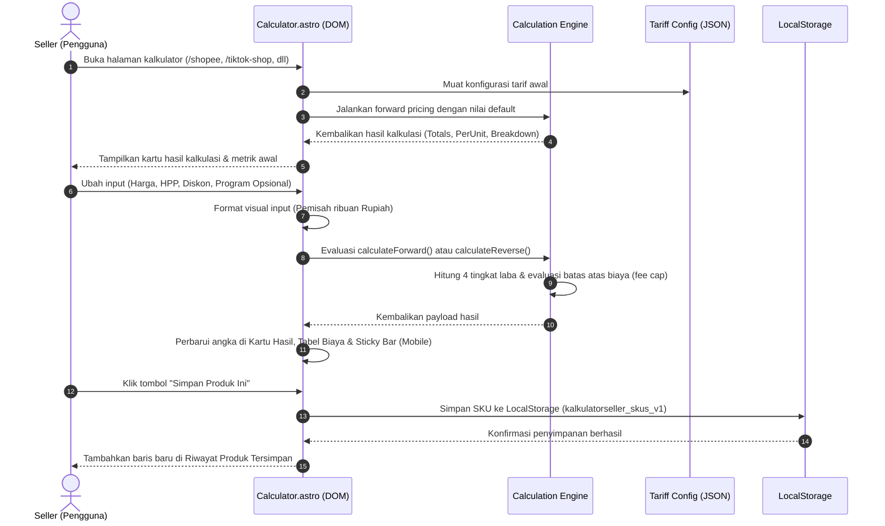

# Alur Kerja Aplikasi (Application Flow)

Dokumen ini menjelaskan alur siklus hidup inisialisasi, input pengguna, evaluasi perhitungan reaktif, dan pembaruan antarmuka pada **KalkulatorSeller**.

---

## 🔁 Siklus Hidup Reaktivitas di Browser

---

## ⚡ Detail Tahapan

### 1. Inisialisasi Halaman
- Astro menyajikan HTML statis yang sudah terisi konten dasar (*pre-rendered HTML*).
- Script klien membaca konfigurasi platform dari atribut data elemen formulir (`data-platform="shopee"`).
- Script langsung mengeksekusi perhitungan forward perdana agar pengguna langsung melihat simulasi angka realistis tanpa harus mengetik terlebih dahulu.

### 2. Penanganan Input Real-time
- Input harga mendengarkan event `input` dan secara otomatis memformat visual angka dengan pemisah ribuan titik (`Rp 100.000`), sementara nilai numerik integer murni (`100000`) dikirimkan ke mesin perhitungan.
- Perubahan dropdown kategori atau checkbox program promosi (seperti *Gratis Ongkir XTRA*) memicu evaluasi ulang seketika (*instant re-calculation*) tanpa kedipan layar (*no flicker*).

### 3. Pembaruan DOM Selektif
- Hanya elemen angka hasil (`#res-net-profit`, `#res-gross-profit`, `#res-admin-fee`, dll.) yang diperbarui teksnya menggunakan `textContent`.
- Format mata uang Rupiah diproses melalui modul `src/utils/currency.js` menggunakan `Intl.NumberFormat('id-ID')`.
