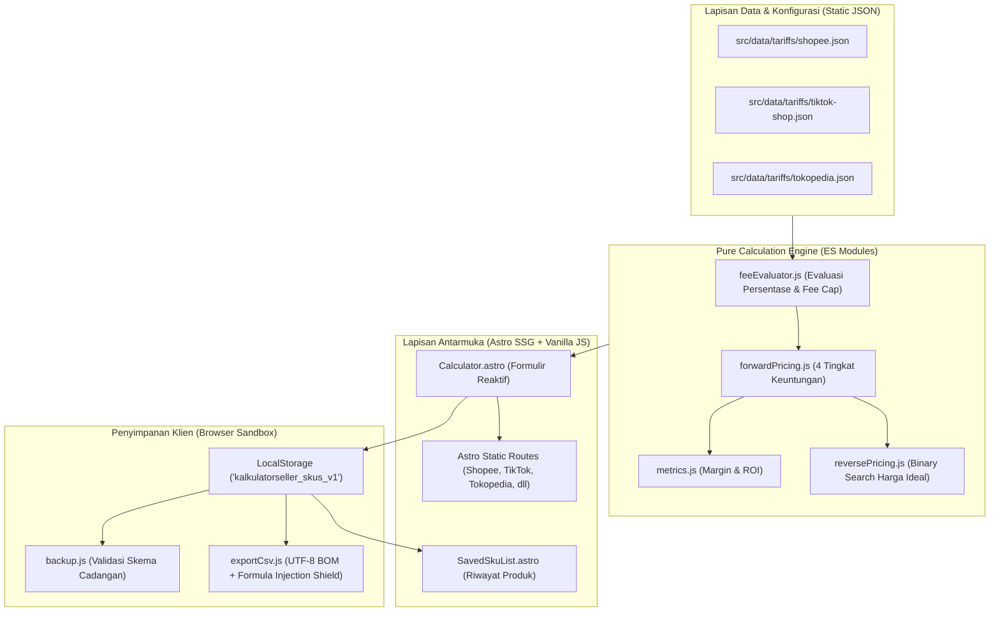

# Gambaran Umum Arsitektur (Architecture Overview)

Dokumen ini menjelaskan rancangan arsitektur sistem **KalkulatorSeller** dari sudut pandang arsitektur perangkat lunak.

---

## 🏗 Prinsip Desain Arsitektur

KalkulatorSeller dibangun dengan pendekatan **Zero-Backend Static Site Generation (SSG)**:
1. **Decoupled Architecture**: Logika komputasi (*Pure Calculation Engine*) terpisah secara mutlak dari lapisan presentasi visual (*UI Layer*). Engine tidak memanggil fungsi DOM peramban sehingga dapat diuji secara independen di lingkungan Node.js atau serverless.
2. **100% Client-Side Privacy**: Tidak ada database terpusat, analitik pelacak, atau endpoint API backend yang mencatat data bisnis seller. Seluruh komputasi dan penyimpanan riwayat dilakukan lokal di browser pengguna.
3. **Configuration-Driven Tariffs**: Struktur tarif komisi dan biaya layanan marketplace dikelola melalui berkas JSON terpisah (`src/data/tariffs/`). Perubahan tarif di kemudian hari tidak memerlukan modifikasi pada algoritma inti.

---

## 📊 Diagram Alur Arsitektur Sistem

---

## 🔄 Pemisahan Tanggung Jawab Modul

| Lapisan | Modul Utama | Tanggung Jawab |
|---|---|---|
| **Data Layer** | `src/data/tariffs/*.json` | Menampung skema tarif biaya admin, komisi, biaya layanan, dan cap per marketplace dengan metadata sumber resmi. |
| **Calculation Engine** | `src/engine/*.js` | Menghitung 4 tingkat profit, mengevaluasi kondisi fee, menghitung rasio margin/ROI, dan melakukan pencarian biner harga jual ideal. Bebas dari manipulasi DOM. |
| **Presentation Layer** | `src/pages/*.astro`, `src/components/*.astro` | Merender HTML statis berkecepatan tinggi, menyediakan markup aksesibel, dan menangani interaktivitas event DOM via Vanilla JavaScript. |
| **Client Storage & Utils** | `src/utils/*.js` | Menyimpan daftar produk ke LocalStorage, membuat file ekspor CSV yang aman dari formula injection, dan memproses cadangan JSON. |
